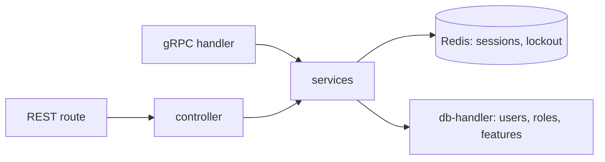

# dashboard-auth

Auth service of the baig.home dashboard: users, email and password login, access and refresh tokens, sessions per browser or device, sign-out tombstones and user access. Started from [go-backend-template](https://github.com/ahmedbaig/go-backend-template) with `scripts/new-service.sh dashboard-auth`.

`dashboard-edge` will call it over gRPC. Until edge exists, the same services are also reachable over a temporary REST API on the admin HTTP port (`httpApi: true`), so every function can be checked from Postman or curl. Both transports call the same service methods; the REST routes get switched off once edge is in place. Design: Obsidian `Go Backend/Auth Design.md`.

## Ports

| Port | What |
|---|---|
| HTTP `127.0.0.1:8081` | `/healthz`, `/healthp`, `/readyz`, `/metrics`, `/api/v1/admin/info`, and the temporary REST API when `httpApi` is on |
| gRPC `127.0.0.1:9081` | `dashboard.auth.v1.AuthService`, gRPC health, reflection on localhost/testing |

## Layout

```
cmd/server/main.go            config → logger → server.Build → run
api/                          module github.com/ahmedbaig/dashboard-auth/api: constants.go (paths, roles), types.go, client
proto/                        auth.proto, generated Go (gen/go) and OpenAPI (openapi), make proto
internal/
  constants/                  app-wide constants: name, issuers, environments, gRPC metadata keys, Redis keys, event names, timings
  config/                     dashboard-auth.json + shared dashboard-services.json + logger config
  server/                     Build: appctx, HTTP app, routes, jobs, gRPC
  appctx/                     context.go holds everything; db.go, redis.go, keys.go, services.go build each piece
  session/                    Redis session store, login lockout, caller + bearer middleware
  tokens/                     Ed25519 keys, access JWT (auth signs), internal user JWT (edge signs)
  http/
    routes/                   REST routes (temporary) and admin info
    controllers/              bind the request, call a service, write the response
    services/                 business logic shared by REST and gRPC: auth, sessions, users
  grpc/                       gRPC server, edge user-token interceptor, handlers that call the same services
  jobs/                       background jobs (db-handler capabilities)
  testutil/fakedb/            in-memory db-handler for tests
test/e2e/                     end-to-end tests through server.Build (HTTP and gRPC)
migrations/                   schema, make migrate
seeds/admin.sql.sample        first admin user, make seed
```

Each package keeps its type declarations in `types.go`; the other files hold functions and methods. Constants shared across packages live in `internal/constants`, the REST contract constants in `api/constants.go`. Unit tests sit in their package as one `_test.go` file. The running version is `version` in `dashboard-auth.json`.

## Request flow



## Tokens and sessions

| | Access | Refresh |
|---|---|---|
| Form | Ed25519 JWT: `sub`, `sid`, `exp`, `kid` | opaque `sid.secret`, stored as sha256 |
| TTL | 10 min | 7 days, sliding |
| Rule | REST: `Authorization: Bearer`; gRPC: edge-signed `x-user-token` | rotated on every use; the previous token works for 30 s, then reuse revokes the session |

Redis keys (prefix `dashboard:`): `session:{sid}`, `user:{id}:sessions`, `revoked:{sid}` (tombstone, TTL = refresh time left), `user:{id}:history`, `grace:{sid}:{hash}`, `login:fail:{email}`. Changes go out on `dashboard:auth.events` as `session.revoked` and `session.changed`.

## Endpoints

| REST | RPC | Needs |
|---|---|---|
| `POST /api/v1/auth/login` | Login | email + password; 5 failures lock the email for 15 min |
| `POST /api/v1/auth/refresh` | Refresh | refresh token |
| `POST /api/v1/auth/logout` | Logout | bearer or refresh token |
| `GET /api/v1/session` | GetSession | a session |
| `GET /api/v1/auth/sessions` | ListSessions | a session |
| `DELETE /api/v1/auth/sessions/{sid}` | RevokeSession | a session |
| `POST /api/v1/auth/sessions/revoke-others` | RevokeOtherSessions | a session |
| `PUT /api/v1/auth/password` | ChangePassword | current password; signs out other sessions |
| `POST /api/v1/auth/users` | CreateUser | `admin` |
| `PUT /api/v1/auth/users/{userId}/access` | SetUserAccess | `admin`; updates every live session of that user |
| `GET /api/v1/admin/info` | | `admin` |

Spec: `proto/openapi/auth.swagger.yaml`, also in the Postman workspace "baig.home dashboard" (`make api-docs`).

## Users

New users only come from the admin API. The first admin is seeded straight into the database:

```sh
brew install argon2
printf '%s' 'your password' | argon2 "$(openssl rand -base64 12)" -id -m 15 -t 2 -p 1 -e
cp seeds/admin.sql.sample ../dashboard-env/var/secrets/dashboard-auth-seed.sql
# put your email, name and the $argon2id$... hash in that file
make seed
```

## Config

`CONFIG_DIR` (default `../dashboard-env/var/secrets` with make, `/app/var/secrets` in Docker):

| File | Keys |
|---|---|
| `dashboard-services.json` (shared) | `auth.{http,grpc}`, `dbHandler.{http,grpc}`, `redis`, `serviceToken`, `keys.{auth,edge}` |
| `dashboard-auth.json` | `version`, `host`, `environment`, `privateKey`, `accessTtl`, `refreshTtl`, `refreshGrace`, `historySize`, `minPasswordLength`, `login`, `dbHandler.{host,instance,timeout}`, `jobs`, `httpApi` |
| `dashboard-auth-logger.json` | go-backend-logging |

## Commands

```sh
make setup        # configs + keys in dashboard-env (keeps existing)
make migrate      # apply migrations
make seed         # first admin from dashboard-auth-seed.sql
make run          # needs db-handler running
make test         # race detector
make proto        # after editing proto/
make api-docs     # regenerate, lint and upload the OpenAPI spec to Postman
make help         # everything else from go-backend-pipelines (lint, check, docker, ...)
```

Until the dashboard repos are published, modules resolve through `GoLangExperiments/go.work`, so `make docker` and CI only work after the push.

## License

MIT
